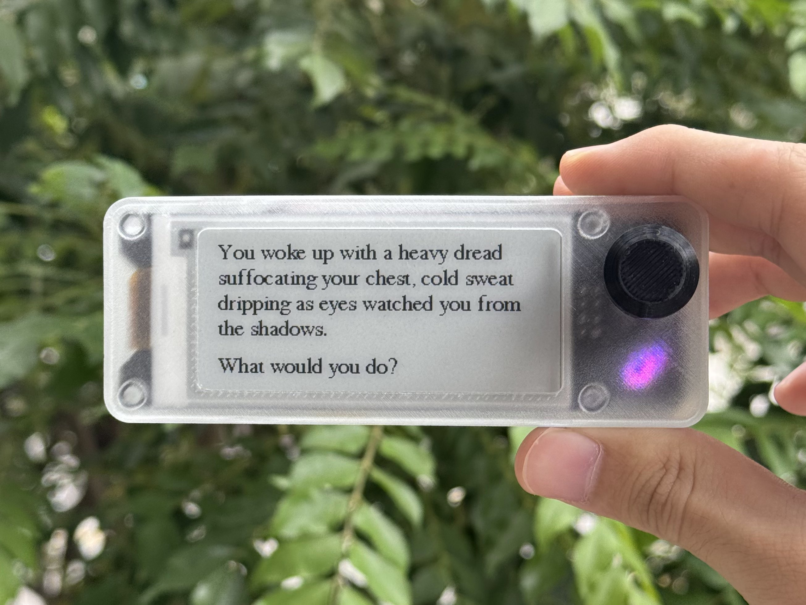
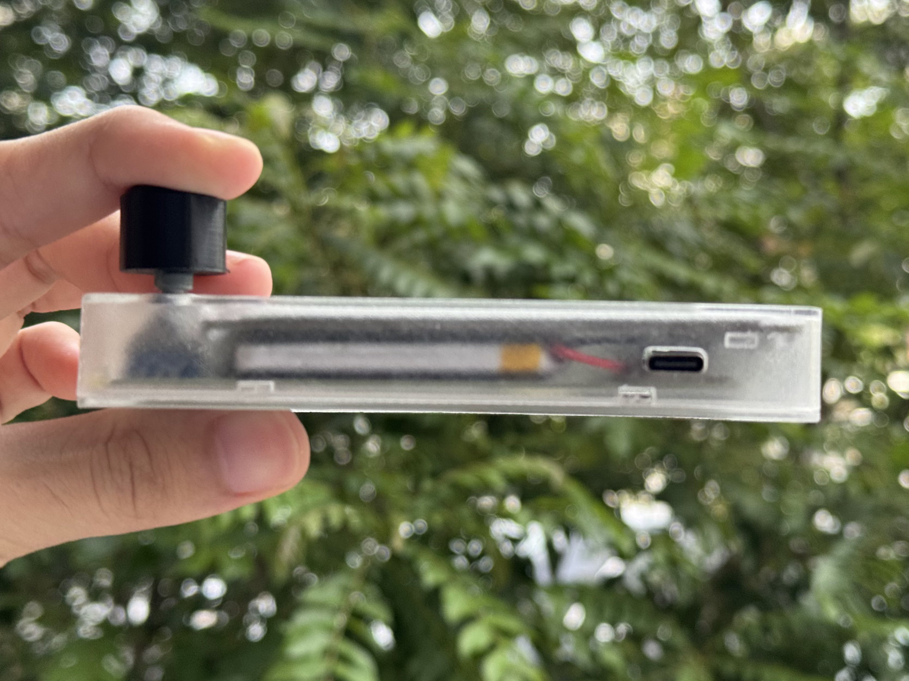
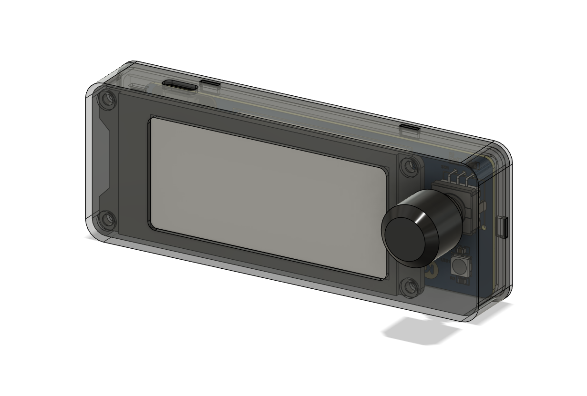
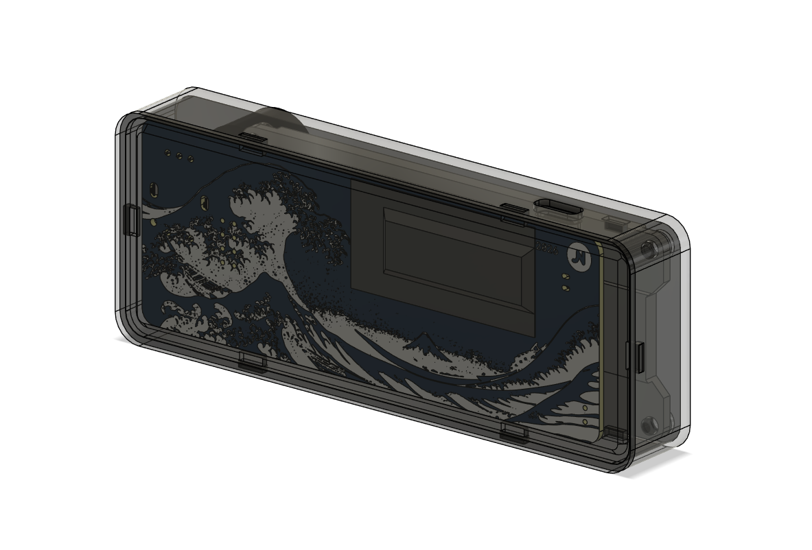
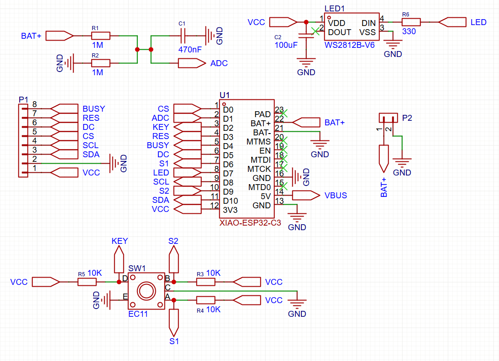
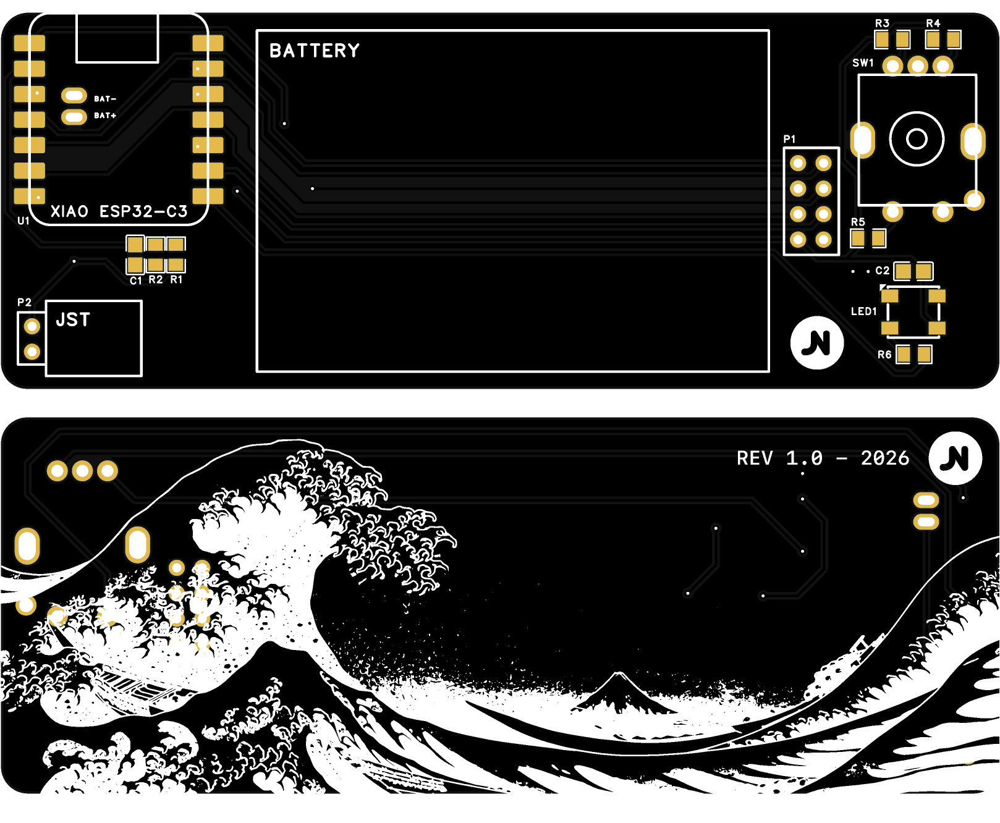

# InkQuest
This is an interactive text adventure game device using an ESP32, an e-paper display and a rotary encoder. It is powered by Gemini to generate infinite stories and choices. 

↑ click to watch demo!

↑ click to watch walkthrough!

## Background
After I had been working with e-paper displays for a while, I noticed most e-paper projects are just a static display that updates once in a while, like a weather station or calendar tracker despite their sleek beauty and low power capability. Inspired by e-readers, I thought: why not make something interactive, something fun, and something handheld?

That is the reason behind InkQuest. You not only can read, but you also get to immerse yourself in the story. This way, we bring the classic choose-your-own-adventure into a modern handheld gaming console.

## Design
This is an interactive text adventure (choose-your-own-adventure) e-paper game with:

* 2.9" E-Paper Display (zero eye strain!)
* Tactile, clicky rotary encoder and RGB LED matching the story atmosphere
* Handheld slim design (just 1.6cm!)
* 1,200mAh battery (~20 hours of use, based on estimation)
* and a sleek design!

In a nutshell, this is how the game flow works:
1. You turn or push the rotary knob to navigate the controls and choose story choices.
2. The ESP32 checks the history buffer (last 5 turns) and make a new JSON payload.
3. The buffer and your choice are sent to Gemini API to process the prompt. Then it returns the new story segment and 4 choices.
4. The ESP32 parse the JSON response and saves the story to the buffer.
5. The e-paper display updates the story text and 4 choices, and the NeoPixel LED changes colour to match the atmosphere.
6. After 2 minutes of inactivity, the ESP32 falls into deep sleep; simply pressing the rotary encoder would wake it up.

## Repository Structure
* `cad/`: CAD assembly and 3D print file.
* `firmware/`: Arduino IDE flash code.
* `hardware/`: PCB EasyEDA Gerber files and schematics.
* `images/`: Some nice project images.

## Bill of Material

| Component | Variation | Quantity | Link |
| -------- | -------- | -------- | -------- |
| XIAO ESP32-C3 | - | 1 | [AliExpress](https://s.click.aliexpress.com/e/_c3eOCW2h) |
| WeAct 2.9inch E-Paper Display | 2.9 inch | 1 | [AliExpress](https://s.click.aliexpress.com/e/_c4pj5khn) |
| 603450 Li-Po Battery | - | 1 | [AliExpress](https://s.click.aliexpress.com/e/_c3nU6hTJ) |
| JST-PH Connector | 2P | 1 | [AliExpress](https://s.click.aliexpress.com/e/_c3N3rmhr) |
| Rotary Encoder EC11 | 20mm D shaft | 1 | [AliExpress](https://s.click.aliexpress.com/e/_c4pAwN4D) |
| WS2812B NeoPixel LED 5050 | - | 1 | [AliExpress](https://s.click.aliexpress.com/e/_c4lxeFXX) |
| PH3.5 Low Profile Pin Connector | 2x4 Male, 2x4 Female | 2 | [AliExpress](https://s.click.aliexpress.com/e/_c2u2lpcp) |
| 0805 Resistor | 1M | 2 | [AliExpress](https://s.click.aliexpress.com/e/_c4bDhEHP) |
| 0805 Resistor | 330 | 1 | [AliExpress](https://s.click.aliexpress.com/e/_c4bDhEHP) |
| 0805 Resistor | 10K | 3 | [AliExpress](https://s.click.aliexpress.com/e/_c4bDhEHP) |
| 0805 Ceramic Capacitor | 470nF | 1 | [AliExpress](https://s.click.aliexpress.com/e/_c2xbXOcz) |
| 0805 Ceramic Capacitor | 100uF | 1 | [AliExpress](https://s.click.aliexpress.com/e/_c2xbXOcz) |

## CAD Design

Designed in Autodesk Fusion

## PCB Schematics

Designed in EasyEDA

## License
This project is licensed under the GNU General Public License v2.0. See the [LICENSE](LICENSE) file for details.
